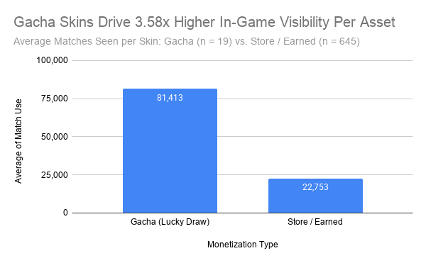

# Marvel Rivals: Cosmetic Monetization A/B Test

## Executive Summary
This project evaluates the return on asset (ROA) of **Gacha (Lucky Draw)** cosmetics versus standard **Store / Earned** skins in *Marvel Rivals*. By scraping live match data from RivalsMeta and cleaning statistical outliers, this analysis proves that while Gacha skins represent only **2.86%** of the analyzed catalog (19 of 664 skins), they generate **3.58x higher average in-game visibility per asset** (81,413 vs. 22,753 matches seen). 

For a live-service studio, this demonstrates that targeted, high-aspiration Gacha releases capture significantly more visual real estate per 3D-modeling dollar than high-volume standard store drops.

---

## Key Results

| Monetization Type | Total Assets Analyzed | Share of Catalog | Avg. Matches Seen per Asset | Efficiency Multiplier |
| :--- | :---: | :---: | :---: | :---: |
| **Gacha (Lucky Draw)** | 19 | 2.86% | **81,413** | **3.58x** |
| **Store / Earned** | 645 | 97.14% | **22,753** | 1.00x (Baseline) |

---

## Methodology & Data Pipeline

### 1. Automated ETL Pipeline (`Python`)
* **Extract:** Built a Python scraper (`requests`, `BeautifulSoup`) to pull live cosmetic telemetry from `rivalsmeta.com/skins` (with a local HTML fallback).
* **Transform:** Engineered Regex patterns to dynamically map each skin to its hero, extract equip rates (`Usage_Percent`) and raw match volume (`Matches_Seen`), deduplicate entries, and tag Gacha assets against the canonical Lucky Draw list.
* **Load:** Exported **673** scraped cosmetics to `marvel_rivals_ab_test_final.csv` for downstream analysis.

### 2. Metric Validation (Why `Matches_Seen` > `Usage_Percent`)
Initial analysis used the tracker's default `Usage_Percent` metric. However, equip rate is hero-dependent—a skin on a hero with only 3 total skins naturally inflates to a higher percentage than a skin on a hero with 20 skins. Pivoting to raw **`Matches_Seen`** eliminated catalog-size bias and measured true global in-game visibility.

### 3. Data Hygiene & Outlier Filtering (`Google Sheets`)
To preserve raw data integrity, a non-destructive `Exclusion_Flag` column was added in Google Sheets to filter out **9** statistical outliers (such as extreme novelty spikes and immature, newly released skins) via Pivot Table filters, leaving a clean sample of **664** assets.

* **Live Analysis & Pivot Table:**
[Google Sheets](https://docs.google.com/spreadsheets/d/1GUARxiWa4xXEO7Mr81ivbvGGrDSiZ8xqFZ-Nq0DRtiA/edit?usp=sharing)

## Business Takeaway
*Marvel Rivals* operates a hit-driven cosmetic economy. Developing 645 standard skins requires massive art, rigging, and VFX overhead for an average return of ~22.7K matches per asset. By contrast, the 19 Gacha skins average ~81.4K matches each. Concentrating high-effort VFX and marketing resources into limited Gacha tiers maximizes player visibility and aspirational value per development hour.

---

## Limitations & Next Steps
* **Visibility vs. Revenue:** `Matches_Seen` is a strong proxy for player adoption and in-game exposure, but does not capture exact ARPPU (Average Revenue Per Paying User) or production cost per skin.
* **Zero-Playrate Exclusion:** Third-party trackers only log cosmetics equipped in recorded matches; unreleased or zero-playrate chromas are excluded from the scraped sample.

---

## Repository Structure
* `Marvel_Rivals_ETL_Pipeline.ipynb` — End-to-end Python scraping, Regex parsing, and CSV export notebook.
* `marvel_rivals_ab_test_final.csv` — Raw scraped dataset (673 skins).
* `chart.png` — Final executive column chart exported from Google Sheets.
